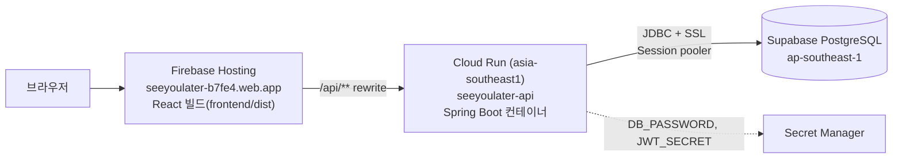
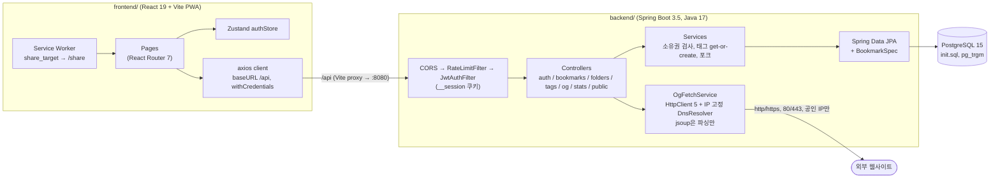
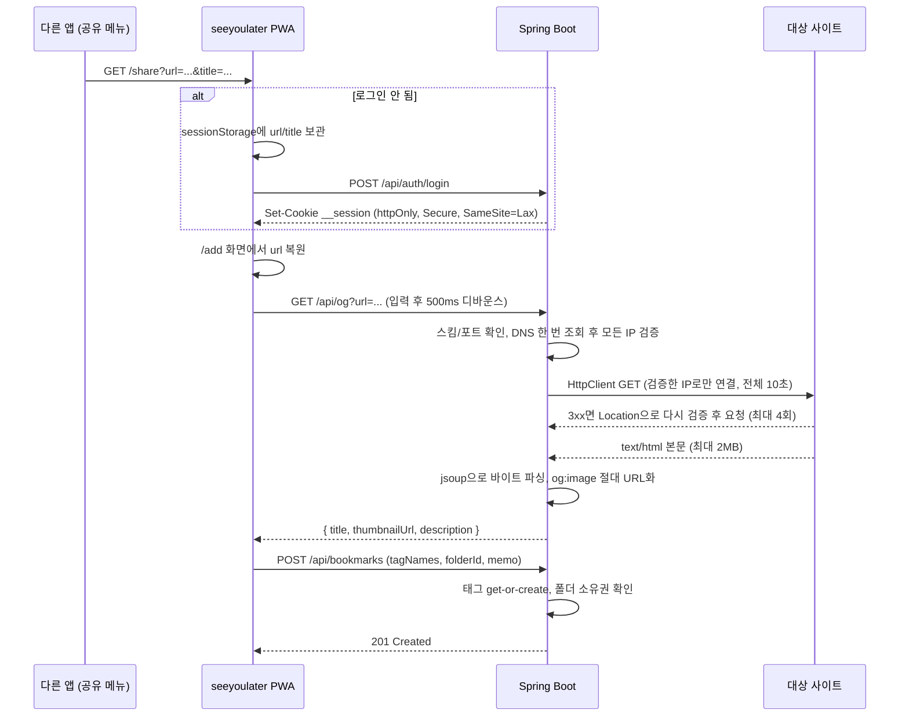
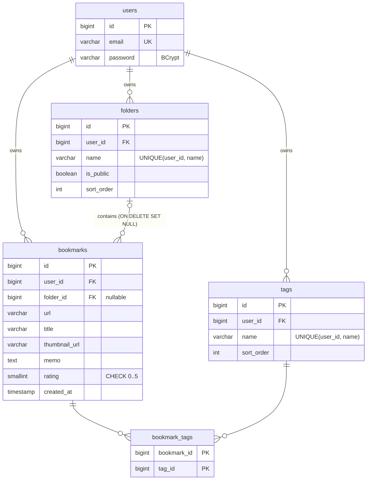

# seeyoulater_

나중에 볼 링크를 폴더와 태그로 정리하고, 저장한 날짜와 추천해 준 사람으로 다시 찾아보는 레트로 Mac 스타일 북마크 매니저입니다. (Spring Boot + React PWA + PostgreSQL)

**[🔖 바로 써보기 → seeyoulater-b7fe4.web.app](https://seeyoulater-b7fe4.web.app/)** (Firebase Hosting + Cloud Run + Supabase)

[🔗 소개 페이지 열기](https://html-preview.github.io/?url=https://github.com/jsj1215/seeyoulater/blob/main/docs/intro.html) · [docs/intro.html](docs/intro.html)

> GitHub Pages를 켜면 `https://jsj1215.github.io/seeyoulater/docs/intro.html` 에서도 볼 수 있습니다.

## 왜 만들었나

"나중에 봐야지" 하고 저장한 링크는 대부분 다시 열리지 않습니다. 직접 겪어 보니 이유는 세 가지였습니다.

- 메신저 나에게 보내기, 브라우저 즐겨찾기, 메모 앱에 링크가 흩어져 있어서 어디에 뒀는지부터 찾아야 합니다.
- URL만 남고 누가 추천했는지, 왜 저장했는지, 얼마나 좋았는지 같은 맥락은 사라집니다.
- 휴대폰에서 본 링크를 정리된 곳에 넣으려면 복사, 앱 전환, 붙여넣기를 거쳐야 합니다.

그래서 URL만 붙여넣으면 제목과 썸네일이 채워지고, 메모와 별점과 출처(`@사람` 태그)를 함께 남기며, 휴대폰 공유 메뉴에서 바로 저장할 수 있는 도구를 만들었습니다.

## 주요 기능

| 기능 | 설명 |
| --- | --- |
| 북마크 저장 | URL 입력 시 서버가 OG 메타데이터(제목, 썸네일, 설명)를 가져와 채움. 메모, 0~5 별점 |
| 폴더 | 폴더 생성/이름 변경/삭제, 폴더별 북마크 수 표시, 공개/비공개 토글, 드래그로 바꾼 순서를 서버에 저장 |
| 태그 | 일반 태그와 `@`로 시작하는 출처 태그. 저장 시 없는 태그는 자동 생성, 이름 변경과 삭제, 드래그 순서 저장 |
| From | 출처 태그(`@사람`)별로 받은 링크 모아 보기 |
| 검색과 필터 | 제목/메모 키워드 + 폴더(미분류 포함) + 여러 태그 조합, 최신/오래된/별점 정렬, 무한 스크롤 |
| 캘린더 | 저장 기록이 있는 날짜 표시, 날짜를 누르면 그날 저장한 링크 |
| Plaza | 다른 사용자가 공개한 폴더 둘러보기, 내 계정으로 포크(복제) |
| 통계 | 전체 링크 수, 폴더 수, 별점 준 링크 수 |
| PWA | 홈 화면 설치, Web Share Target으로 다른 앱의 공유 메뉴에서 바로 저장 |

## 시작하기

### 필수 환경

- JDK 17 또는 21 (Gradle Wrapper 8.7 포함, 별도 Gradle 설치 불필요). Gradle 8.7은 JDK 24 위에서 돌지 않으니 JDK 24가 기본이라면 `JAVA_HOME`을 17이나 21로 잡아 주세요. 컴파일 대상은 Java 17로 고정돼 있습니다.
- Node.js 20.19 이상 (Vite 8 요구사항)
- Docker (PostgreSQL 15 실행용)

### 1. 데이터베이스 실행

```bash
docker compose up -d
```

`docker-compose.yml`이 PostgreSQL 15 컨테이너(`seeyoulater-db`)를 띄우고, 볼륨이 비어 있을 때 `init.sql`을 실행해 테이블과 인덱스를 만듭니다. 포트는 `127.0.0.1:5432`에만 바인딩되어 같은 네트워크의 다른 기기에서는 접속할 수 없습니다. 계정은 `seeyoulater`, 비밀번호는 `POSTGRES_PASSWORD` 환경변수로 바꿀 수 있고 기본값은 `seeyoulater`입니다. 비밀번호를 바꿨다면 백엔드의 `DB_PASSWORD`도 같은 값으로 맞춰야 합니다.

#### 이미 쓰던 DB가 있다면

`init.sql`은 빈 볼륨에서만 자동 실행됩니다. 이전 버전으로 만든 DB에는 폴더/태그의 `sort_order` 컬럼과 `lower(title)`, `lower(memo)` 표현식 인덱스가 없으므로, 백엔드를 띄우기 전에 `init.sql`을 한 번 다시 실행하세요. 파일 전체가 여러 번 실행해도 안전하게(`IF NOT EXISTS`, `ADD COLUMN IF NOT EXISTS`) 작성돼 있습니다.

```bash
docker compose exec -T postgres psql -U seeyoulater -d seeyoulater -v ON_ERROR_STOP=1 < init.sql
```

이 단계를 건너뛰면 기본 설정(`ddl-auto: validate`)에서는 컬럼이 없어 기동에 실패하고, `local` 프로파일(`ddl-auto: update`)에서는 기존 행이 있는 테이블에 NOT NULL 컬럼을 추가하다 실패할 수 있습니다.

### 2. 백엔드 환경변수 설정

```bash
cp backend/.env.example backend/.env
openssl rand -base64 48   # 출력값을 backend/.env 의 JWT_SECRET= 뒤에 붙여 넣기
```

| 변수 | 필수 | 설명 |
| --- | --- | --- |
| `JWT_SECRET` | 예 | Base64로 인코딩한 256bit 이상 키. 기본값이 없어서 비어 있으면 서버가 기동하지 않음 |
| `DB_URL` | 아니오 | 기본값 `jdbc:postgresql://localhost:5432/seeyoulater` |
| `DB_USERNAME` | 아니오 | 기본값 `seeyoulater` |
| `DB_PASSWORD` | 아니오 | 기본값 `seeyoulater` (docker-compose 기본값과 동일) |
| `COOKIE_SECURE` | 아니오 | 인증 쿠키의 `Secure` 플래그. 기본값 `true`. Safari로 `http://localhost`에서 개발할 때만 `false` |
| `CORS_ALLOWED_ORIGINS` | 아니오 | 허용할 프론트엔드 Origin, 콤마로 여러 개 지정. 기본값 `http://localhost:5173` |

docker-compose 쪽에서는 `POSTGRES_PASSWORD`(기본값 `seeyoulater`)로 DB 비밀번호를 정합니다. 이 값은 `backend/.env`가 아니라 docker compose를 실행하는 셸의 환경변수(또는 저장소 루트의 `.env`)에서 읽고, 볼륨을 처음 만들 때만 적용됩니다.

Chrome과 Firefox는 `http://localhost`에서도 `Secure` 쿠키를 저장하므로 대부분 `COOKIE_SECURE`를 건드릴 필요가 없습니다. Safari는 저장하지 않아 로그인이 유지되지 않으니 그때만 `false`로 바꾸세요.

`application.yml`에 `spring.config.import: optional:file:.env[.properties]`가 있어서, 작업 디렉터리 기준 `.env` 파일을 Spring이 프로퍼티로 읽습니다. `./gradlew bootRun`은 `backend/`에서 실행되므로 `backend/.env`가 적용됩니다. 같은 이름의 OS 환경변수를 설정해도 됩니다.

### 3. 백엔드 실행

```bash
cd backend
./gradlew bootRun
```

`http://localhost:8080`에서 API가 뜹니다. 스키마는 `init.sql`이 관리하고 애플리케이션은 `ddl-auto: validate`로 검증만 합니다. 인증이 필요한 API를 쿠키 없이 호출하면 401이 돌아옵니다.

### 4. 프론트엔드 실행

```bash
cd frontend
npm install
npm run dev
```

`http://localhost:5173`에 접속해 회원가입 후 사용합니다. Vite dev server가 `/api` 요청을 `http://localhost:8080`으로 프록시합니다.

| 스크립트 | 동작 |
| --- | --- |
| `npm run dev` | 개발 서버 |
| `npm run build` | `tsc -b` 타입 체크 후 프로덕션 빌드 (`dist/`) |
| `npm run lint` | ESLint |
| `npm run preview` | 빌드 결과 미리보기 |

## 배포

데모는 화면, API 서버, DB를 각각 맞는 서비스에 올렸습니다.



- **같은 도메인으로 묶기**: Firebase Hosting이 `/api/**` 요청을 Cloud Run으로 넘깁니다(`firebase.json`). 화면과 API가 같은 출처라 CORS 없이 쿠키 인증이 동작합니다.
- **쿠키 이름 `__session`**: Firebase Hosting은 Cloud Run으로 요청을 넘길 때 `__session` 쿠키만 전달하고 나머지 쿠키는 지웁니다. 그래서 인증 쿠키 이름을 이것으로 정했습니다(`auth/AuthCookie.java`).
- **리전**: Supabase DB가 싱가포르에 있어서 Cloud Run도 싱가포르(`asia-southeast1`)에 두었습니다. 서버와 DB 사이 왕복이 쿼리마다 생기기 때문에, 사용자와 서버 사이 거리보다 서버와 DB 사이 거리가 응답 시간에 더 크게 영향을 줍니다.
- **Supabase 접속**: 기본 Direct connection은 IPv6 전용이라 IPv4로 접속하는 Cloud Run에서는 **Session pooler** 주소를 씁니다. 무료 플랜의 동시 접속 수를 고려해 커넥션 풀을 5개로 줄였습니다(`SPRING_DATASOURCE_HIKARI_MAXIMUM_POOL_SIZE=5`).
- **시크릿**: DB 비밀번호와 JWT 키는 Secret Manager에 두고, Cloud Run 전용 서비스 계정(`seeyoulater-api@…`)에는 이 두 시크릿의 읽기 권한만 줬습니다.
- **인스턴스**: 요청이 없으면 0대로 줄어들어 비용이 거의 들지 않고, 대신 첫 요청은 서버 기동 시간(약 10초)이 더해집니다. 요청 횟수 제한을 서버 메모리에 기록하므로 최대 1대로 고정했습니다.
- **클라이언트 IP**: 요청 횟수 제한은 `X-Forwarded-For`를 오른쪽부터 신뢰하는 프록시 수만큼 건너뛰어 사용자 IP를 구합니다(`config/ClientIpResolver.java`). 배포 환경에서 실제 헤더를 확인한 결과 `사용자 IP, Firebase 프록시` 뒤에 Google 내부 주소로 연결돼서 `RATE_LIMIT_TRUSTED_PROXY_HOPS=2`로 설정했습니다. Firebase Hosting은 클라이언트가 보낸 `X-Forwarded-For` 값을 지우고 새로 채웁니다.

### 다시 배포하기

```bash
# 백엔드: Cloud Build가 backend/Dockerfile로 이미지를 빌드해 배포. 기존 환경변수와 시크릿 설정은 그대로 유지됨
gcloud run deploy seeyoulater-api --source backend --region asia-southeast1 --project seeyoulater-b7fe4

# 프론트엔드
cd frontend && npm run build && cd ..
firebase deploy --only hosting --project seeyoulater-b7fe4
```

처음 배포할 때 Cloud Run에 넣은 설정은 다음과 같습니다. 값이 비밀인 항목은 Secret Manager 참조로 넣었습니다.

| 환경변수 | 값 |
| --- | --- |
| `DB_URL` | `jdbc:postgresql://<Supabase Session pooler 호스트>:5432/postgres?sslmode=require` |
| `DB_USERNAME` | `postgres.<Supabase 프로젝트 ref>` |
| `DB_PASSWORD` | Secret Manager `seeyoulater-db-password` |
| `JWT_SECRET` | Secret Manager `seeyoulater-jwt-secret` (`openssl rand -base64 48`) |
| `CORS_ALLOWED_ORIGINS` | `https://seeyoulater-b7fe4.web.app` |
| `COOKIE_SECURE` | `true` |
| `RATE_LIMIT_TRUSTED_PROXY_HOPS` | `2` |
| `SPRING_DATASOURCE_HIKARI_MAXIMUM_POOL_SIZE` | `5` |

DB 스키마는 Supabase SQL Editor에서 `init.sql`을 실행해 만들었습니다. 서버는 `ddl-auto: validate`로 시작할 때 엔티티와 테이블 구조가 맞는지 검사합니다.

## 기술 설계

### 아키텍처



### 요청 흐름: 공유 시트에서 저장하기



### 데이터 모델



### 핵심 설계 결정

**1. JWT를 httpOnly 쿠키로 전달**

- 결정: 로그인/가입 응답에서 `__session` 쿠키(httpOnly, Secure, SameSite=Lax, Max-Age 7일)를 내려주고, `JwtAuthFilter`가 쿠키에서 토큰을 꺼내 검증합니다. 세션은 STATELESS이고, 인증 없이 보호된 API를 부르면 401을 돌려줍니다.
- 이유: 프론트엔드 코드가 토큰을 읽거나 저장하지 않으므로 XSS로 토큰이 새어 나갈 경로가 줄어듭니다. 새로고침하면 `GET /api/auth/me`로 로그인 상태를 복원하고, 사용 중에 401을 받으면 axios 인터셉터가 로그아웃 상태로 바꿔 `/login`으로 보냅니다.
- 대안과 트레이드오프: `localStorage` + `Authorization` 헤더 방식은 구현이 단순하지만 스크립트에서 토큰에 접근할 수 있습니다. 현재 구조에는 리프레시 토큰과 서버 측 토큰 폐기가 없어 로그아웃은 쿠키 삭제뿐이고, CSRF 토큰은 끈 채 SameSite=Lax에 기대고 있습니다. `/api/auth/logout`은 토큰이 만료되거나 깨져 있어도 쿠키를 지울 수 있게 인증 없이 열어 두었습니다.
- 근거: `backend/.../config/JwtAuthFilter.java`, `config/SecurityConfig.java`, `auth/AuthController.java`, `frontend/src/api/client.ts`, `frontend/src/store/authStore.ts`

**2. OG 메타데이터는 서버에서 수집하고 SSRF를 막음**

- 결정: 백엔드가 Apache HttpClient 5로 대상 페이지를 받고, jsoup은 받은 바이트를 파싱하는 데만 씁니다. 스킴은 http/https, 포트는 80/443(생략 포함)만 허용합니다. HttpClient의 `DnsResolver`를 직접 구현해 DNS를 한 번만 조회하고, 나온 IP를 모두 검사한 뒤 그 IP로만 연결합니다. 리다이렉트는 자동으로 따라가지 않고 최대 4번까지 직접 따라가면서 홉마다 스킴, 포트, IP를 다시 검증합니다. 응답은 `text/html`일 때만 파싱하고 본문은 2MB, 전체 시간은 10초로 묶습니다. `og:image`는 최종 URL 기준 절대 경로로 바꾸고 http/https가 아니면 버립니다.
- 차단 대역: loopback, 사설 대역(10/8, 172.16/12, 192.168/16), link-local(169.254/16, 클라우드 메타데이터 포함), `0.0.0.0/8`, CGNAT `100.64.0.0/10`, 벤치마크용 `198.18.0.0/15`, 멀티캐스트와 예약 대역, IPv6 `fc00::/7`, `fe80::/10`, `::/96`. IPv4-mapped(`::ffff:a.b.c.d`), NAT64, 6to4처럼 IPv6 안에 IPv4를 담은 주소는 안쪽 IPv4로 다시 검사합니다. 차단된 주소면 400, 그 밖의 실패는 빈 메타데이터를 돌려줘 저장 자체는 막지 않습니다.
- 이유: 다른 사이트의 HTML은 CORS 때문에 브라우저에서 읽을 수 없습니다. 서버가 대신 요청하면 내부망 접근 통로가 될 수 있습니다. jsoup은 연결할 IP를 지정할 수 없어서, 검증 시점과 연결 시점의 DNS 응답이 다르게 오는 DNS 재바인딩을 막으려고 HTTP 클라이언트를 바꿨습니다. 호스트명은 그대로 두기 때문에 TLS SNI와 인증서 검증은 정상 동작합니다.
- 대안과 트레이드오프: 외부 링크 프리뷰 API를 쓰면 SSRF 걱정은 없지만 외부 의존과 비용이 생깁니다. 지금 방식도 공인 IP의 80/443 포트로는 요청이 나가므로, 서버가 공인 IP로 노출된 다른 서비스에 요청을 보내는 것까지 막지는 못합니다.
- 근거: `backend/.../ogfetch/OgFetchService.java`, `ogfetch/OgFetchServiceTest.java`, `frontend/src/components/OgPreview.tsx`

**3. 검색 조건을 JPA Specification으로 조합**

- 결정: `BookmarkSpec`에 소유자, 키워드(제목/메모), 태그 ID 목록, 폴더(`-1`은 미분류), 날짜, 별점 여부 조건을 각각 정의하고 값이 있는 것만 AND로 묶습니다. 키워드에 들어온 `%`, `_`, `\`는 이스케이프해서 글자 그대로 찾고, 조건은 `lower(col) LIKE lower(:kw)` 모양을 유지해 `init.sql`의 `lower(title)`, `lower(memo)` pg_trgm GIN 표현식 인덱스를 탈 수 있게 했습니다.
- 이유: 선택 필터가 다섯 개라 메서드 이름 쿼리로는 조합 수만큼 메서드가 필요합니다. 같은 조각을 폴더별 북마크 수, 캘린더 날짜 조회, 공개 폴더 조회, 포크에서 다시 씁니다.
- 대안과 트레이드오프: QueryDSL은 타입 안정성이 더 좋지만 코드 생성 설정이 추가됩니다. 현재 태그 필터는 OR(`IN`) + `distinct`이고, 폴더 목록은 폴더마다 count 쿼리를 보내 폴더 수만큼 쿼리가 나갑니다. 정렬은 `newest`(기본, 저장일 내림차순), `oldest`, `starred`(별점 내림차순 후 최신순) 세 가지이고, 페이지 크기는 최대 100으로 자릅니다.
- 근거: `backend/.../bookmark/BookmarkSpec.java`, `bookmark/BookmarkService.java`, `folder/FolderService.java`, `init.sql`

**4. 스키마는 `init.sql`이 소유하고 Hibernate는 검증만**

- 결정: 테이블, 인덱스, 제약은 `init.sql`이 만들고 애플리케이션은 `ddl-auto: validate`로 엔티티와 스키마가 맞는지 확인합니다.
- 이유: pg_trgm 확장, GIN 인덱스, 별점 `CHECK (0~5)`, 폴더 삭제 시 북마크를 미분류로 돌리는 `ON DELETE SET NULL`, 태그 연결의 `ON DELETE CASCADE`를 DB에 직접 두기 위해서입니다. 엔티티가 스키마와 어긋나면 기동 시점에 바로 실패합니다.
- 대안과 트레이드오프: `ddl-auto: update`는 편하지만 위 제약을 표현하기 어렵고 운영 DB를 예측할 수 없게 바꿉니다. 대신 마이그레이션 도구가 없어 스키마 변경은 수동 SQL입니다. `init.sql`은 빈 볼륨에서만 자동 실행되므로, 기존 DB용 변경도 같은 파일 끝에 다시 실행해도 안전한 형태로 넣어 두고 직접 한 번 더 돌리는 방식으로 맞춥니다(위 "이미 쓰던 DB가 있다면" 참고).
- 근거: `init.sql`, `backend/src/main/resources/application.yml`, `docker-compose.yml`

**5. 출처는 별도 테이블 대신 `@` 태그 규칙**

- 결정: 이름이 `@`로 시작하는 태그를 "이 링크를 알려 준 사람/곳"으로 취급합니다. 태그는 사용자별로 유일(`UNIQUE(user_id, name)`)하고, 북마크 저장 시 없는 태그는 만듭니다.
- 이유: 출처도 링크를 묶는 라벨이므로 태그 검색, 필터, 이름 변경을 그대로 재사용할 수 있습니다. From 화면과 태그 관리 화면은 접두어로만 두 종류를 나눕니다.
- 대안과 트레이드오프: `sources` 테이블을 따로 두면 사람별 속성을 붙이기 쉽지만 기능을 두 벌 만들어야 합니다. 지금은 구분이 이름 규칙에만 있어 DB 차원의 강제는 없습니다.
- 근거: `BookmarkService#getOrCreateTags`, `frontend/src/pages/FromPage.tsx`, `pages/TagsPage.tsx`

**6. 공유 시트 진입 시 로그인을 거쳐도 링크 유지**

- 결정: PWA manifest의 `share_target`이 `/share?url=&title=&text=`로 들어오면, 로그인 상태면 바로 추가 화면으로 넘기고 아니면 URL을 `sessionStorage`에 보관했다가 로그인 후 추가 화면에서 꺼냅니다. URL을 `text`로 넘기는 앱을 위해 `url`이 없으면 `text`를 씁니다.
- 이유: 공유 메뉴로 들어온 시점에 쿠키가 만료돼 있어도 링크를 잃지 않게 하려는 것입니다.
- 대안과 트레이드오프: `sessionStorage`라 탭을 닫으면 대기 중인 링크가 사라집니다. 서비스 워커는 정적 자산만 precache하고 `/api` 응답은 개인 데이터라 캐시하지 않습니다(`navigateFallbackDenylist`에 `/api` 포함). 그래서 오프라인에서는 목록 조회도 저장도 되지 않습니다. 로그아웃할 때는 Cache Storage를 비워 다음 사용자에게 이전 데이터가 남지 않게 합니다.
- 근거: `frontend/vite.config.ts`, `pages/ShareTargetPage.tsx`, `pages/AddLinkPage.tsx`, `hooks/useAuth.ts`

### API 요약

`/api/auth/signup`, `/api/auth/login`, `/api/auth/logout`, `/api/public/**`만 인증 없이 호출할 수 있고, 나머지는 쿠키가 없거나 토큰이 유효하지 않으면 401입니다. 다른 사용자의 북마크, 폴더, 태그 id로 요청하면 403이 아니라 없는 id와 같은 404를 돌려줘 id 존재 여부가 드러나지 않습니다.

| 메서드 | 경로 | 설명 |
| --- | --- | --- |
| POST | `/api/auth/signup` | 가입 + 쿠키 발급. 비밀번호 8~72자(UTF-8 72바이트 이하). 이미 있는 이메일이거나 가입자 수가 `app.max-users` 이상이면 409. 분당 5회 |
| POST | `/api/auth/login` | 로그인 + 쿠키 발급. 분당 10회 |
| POST | `/api/auth/logout` | 쿠키 만료 (인증 불필요) |
| GET | `/api/auth/me` | 현재 사용자 |
| GET | `/api/bookmarks` | `keyword`, `tagIds`, `folderId`, `date`, `sortBy`(`newest`/`oldest`/`starred`), `starredOnly`, `page`, `size`(기본 20, 최대 100)로 검색 |
| GET | `/api/bookmarks/dates` | `year`, `month`에 저장 기록이 있는 날짜. 잘못된 월이면 400 |
| POST / GET / PUT / DELETE | `/api/bookmarks`, `/api/bookmarks/{id}` | 북마크 CRUD |
| PATCH | `/api/bookmarks/{id}/rating` | 별점만 변경 |
| GET / POST | `/api/folders` | 내 폴더 목록(저장된 순서, 북마크 수 포함), 생성 |
| PUT | `/api/folders/order` | `{ "ids": [...] }` 순서대로 폴더 순서 저장. 요청에 없는 폴더는 기존 순서대로 뒤에 붙음 |
| PUT / DELETE | `/api/folders/{id}` | 이름 변경, 삭제 |
| PATCH | `/api/folders/{id}/visibility` | 공개/비공개 토글 |
| POST | `/api/folders/{id}/fork` | 공개 폴더 복제. url, 제목, 썸네일만 복사하고 메모, 태그, 별점은 가져오지 않음. 이름 중복 시 ` (1)` 접미사. 내 폴더면 400, 비공개이거나 없으면 404 |
| GET / POST / PUT / DELETE | `/api/tags`, `/api/tags/{id}` | 태그 목록(저장된 순서), 생성, 이름 변경, 삭제 |
| PUT | `/api/tags/order` | `{ "ids": [...] }` 순서대로 태그 순서 저장 |
| GET | `/api/og?url=` | OG 메타데이터. 분당 30회 |
| GET | `/api/stats` | 전체/폴더/별점 링크 수 |
| GET | `/api/public/folders` | 공개 폴더 목록. `{ id, name, ownerName, bookmarkCount, createdAt }`만 내려주며 `ownerName`은 `su***`처럼 마스킹하고 이메일은 넣지 않음 |
| GET | `/api/public/folders/{id}/bookmarks` | 공개 폴더의 북마크. `{ id, url, title, thumbnailUrl, createdAt }`만 내려줌. 비공개이거나 없으면 404 |

로그인, 가입, OG 조회는 IP별로 분당 횟수를 제한하고, 넘으면 429와 `Retry-After: 60` 헤더를 돌려줍니다.

## 기술 스택

| 영역 | 사용 기술 |
| --- | --- |
| Frontend | React 19, TypeScript, Vite 8, React Router 7, Zustand 5, axios, vite-plugin-pwa (Workbox) |
| Backend | Java 17, Spring Boot 3.5.16, Spring Web, Spring Data JPA, Spring Security, Bean Validation |
| 인증 | JJWT 0.13.0 (HS 서명), BCrypt |
| 크롤링 | Apache HttpClient 5 (요청), jsoup 1.17.2 (파싱) |
| 테스트 | JUnit 5, Spring Boot Test, Spring Security Test, H2 (PostgreSQL 호환 모드) |
| Database | PostgreSQL 15, pg_trgm |
| 인프라 | Docker Compose (로컬 DB) |

## 프로젝트 구조

```
seeyoulater/
├── backend/
│   ├── build.gradle.kts
│   ├── .env.example                 # JWT_SECRET, DB_*, COOKIE_SECURE, CORS 템플릿
│   └── src/
│       ├── test/                    # API 통합 테스트, SSRF 테스트 (H2)
│       └── main/
│       ├── java/com/sujin/seeyoulater/
│       │   ├── auth/                # 가입, 로그인, 전역 예외 처리
│       │   ├── bookmark/            # 엔티티, Specification 검색, CRUD
│       │   ├── folder/              # 폴더, 공개 폴더(Plaza), 포크
│       │   ├── tag/
│       │   ├── ogfetch/             # OG 메타데이터 수집 + SSRF 검증
│       │   ├── stats/
│       │   ├── user/
│       │   └── config/              # Security, JWT, CORS, rate limit
│       └── resources/application.yml
├── frontend/
│   ├── vite.config.ts               # PWA manifest, share_target, /api 프록시
│   └── src/
│       ├── api/                     # 엔드포인트별 axios 함수
│       ├── pages/                   # Home, View, Add/Edit, Folders, Tags, From, Calendar, Plaza ...
│       ├── components/
│       ├── hooks/
│       └── store/authStore.ts
├── docs/intro.html                  # 소개 페이지
├── init.sql                         # PostgreSQL 스키마
└── docker-compose.yml
```

## 테스트

백엔드 테스트는 75개입니다. PostgreSQL 없이 H2를 PostgreSQL 호환 모드로 띄워 실행하므로 Docker를 켜지 않아도 됩니다.

```bash
cd backend
./gradlew test    # JDK 17 또는 21에서 실행 (Gradle 8.7 wrapper는 JDK 24에서 동작하지 않음)
```

| 테스트 클래스 | 개수 | 다루는 내용 |
| --- | --- | --- |
| `AuthApiTest` | 12 | 미인증 401, 깨진 토큰 401, CORS preflight, 쿠키 속성(httpOnly, Secure), 72바이트 비밀번호 제한, 중복 가입 409, IP 기준 로그인 11번째 요청 429, 계정 기준 5회 실패 잠금(IP를 바꿔도 적용), 로그인 성공 시 실패 횟수 초기화, 토큰이 깨져도 로그아웃 가능 |
| `ClientIpResolverTest` | 4 | 신뢰 프록시 수에 따른 클라이언트 IP 선택, 위조된 `X-Forwarded-For` 앞부분 무시, 헤더가 짧을 때 처리 |
| `ResourceApiTest` | 12 | 남의 북마크 404, 기본 정렬 최신순, 태그 필터(`tagIds` 반복 파라미터), 페이지 크기 상한, URL 수정 반영, http(s) 외 URL과 길이 초과 거부, LIKE 와일드카드 이스케이프, 잘못된 월 400, 폴더/태그 순서 저장, 공개 API 응답 필드, 포크 규칙 |
| `OgFetchServiceTest` | 47 | 차단/허용 IP 목록(파라미터 테스트 39건), 상대 경로 og:image 처리, 리다이렉트 홉별 재검증과 최대 횟수, HTML이 아닌 응답 무시, 연결 시점 DNS 재검증 |

테스트가 H2에서 돌기 때문에 pg_trgm 인덱스가 실제로 쓰이는지는 테스트로 확인하지 않습니다.

프론트엔드는 다음으로 검증합니다.

```bash
cd frontend
npm run lint    # ESLint
npm run build   # tsc -b 타입 체크 + 빌드
```

## 보안과 환경변수 메모

- 시크릿은 저장소에 넣지 않습니다. `JWT_SECRET`과 DB 접속 정보는 환경변수 또는 gitignore 대상인 `backend/.env`로 주입합니다. 저장소에는 템플릿인 `backend/.env.example`만 있고, 여기에 든 값은 로컬 개발용 기본값뿐이며 `JWT_SECRET`은 비어 있습니다.
- `JWT_SECRET`은 기본값이 없습니다. 비어 있으면 애플리케이션이 시작되지 않으므로 키 누락을 운영 중이 아니라 기동 시점에 알 수 있습니다.
- docker-compose의 DB 비밀번호 기본값(`seeyoulater`)은 로컬 개발 전용입니다. 다른 환경에서는 `POSTGRES_PASSWORD`와 `DB_URL`, `DB_USERNAME`, `DB_PASSWORD`로 바꿉니다. DB 포트는 `127.0.0.1`에만 열립니다.
- 인증 쿠키는 httpOnly, `Secure`(`COOKIE_SECURE`, 기본 `true`), SameSite=Lax입니다.
- CORS 허용 출처는 `CORS_ALLOWED_ORIGINS`로 정하고, Spring Security 필터 체인 맨 앞에서 처리해 401, 429 응답과 preflight에도 CORS 헤더가 붙습니다.
- 비밀번호는 BCrypt로 해시합니다. BCrypt는 72바이트 이후를 무시하므로(CVE-2025-22228) 글자 수 8~72자에 더해 UTF-8 바이트 기준 72바이트도 검사합니다.
- 로그인 실패는 이메일 존재 여부와 관계없이 같은 401 메시지를 반환하고, 없는 이메일이어도 더미 해시와 BCrypt 비교를 한 번 해서 응답 시간 차이로 가입 여부를 추측하기 어렵게 했습니다. 중복 가입은 이메일을 되풀이하지 않는 일반 메시지와 함께 409입니다.
- 북마크, 폴더, 태그는 모두 `findByIdAndUserId`로 조회해 남의 리소스는 404로 응답합니다.
- 입력 검증: URL과 썸네일 URL은 http(s)만, 각각 2048자 이하. 제목 500자, 메모 10000자, 북마크당 태그 30개, 태그명 100자(북마크 저장 시 넘기는 `tagNames`에도 같은 제한), 폴더명 200자.
- 로그인 분당 10회, 가입 분당 5회, `/api/og` 분당 30회를 IP별로 제한합니다(`RateLimitFilter`, 인메모리). 프록시 뒤에서는 `ClientIpResolver`가 신뢰하는 프록시가 덧붙인 값만 사용자 IP로 씁니다.
- 로그인은 계정 단위로도 제한합니다. 같은 이메일로 15분 안에 5번 실패하면 15분 동안 잠기고, 잠긴 동안에는 비밀번호가 맞아도 429를 돌려줍니다(`auth/LoginAttemptLimiter.java`). Cloud Run 주소로 직접 요청하면서 `X-Forwarded-For`를 바꿔 IP 기준 제한을 피하더라도, 한 계정에 비밀번호를 계속 대입할 수는 없습니다. 없는 이메일에도 같은 규칙을 적용해 응답으로 가입 여부를 알 수 없게 했습니다.
- 프론트엔드는 외부 썸네일과 파비콘을 `referrerPolicy="no-referrer"`로 불러오고, 파비콘은 제3자 서비스 대신 각 사이트의 `/favicon.ico`를 직접 요청합니다. `npm audit --omit=dev` 기준 운영 의존성 취약점은 0건입니다.
- 가입 인원은 `app.max-users`(현재 `application.yml` 값 1000)로 제한합니다.
- `application-local.yml`은 gitignore 대상이라 저장소에 없습니다. `--spring.profiles.active=local`로 로컬 전용 설정을 덮어쓸 때만 직접 만들어 쓰면 됩니다.

## 알려진 한계

- **rate limit은 단일 인스턴스 전제**: 버킷과 로그인 실패 기록을 서버 메모리에 두므로 인스턴스를 여러 대로 늘리면 인스턴스마다 따로 세고, 서버가 재시작되면 초기화됩니다. 데모는 Cloud Run 최대 인스턴스를 1로 고정했습니다.
- **Cloud Run 주소 직접 호출**: Firebase Hosting이 Cloud Run을 호출하려면 서비스가 공개돼 있어야 해서 `…run.app` 주소로 직접 요청할 수 있습니다. 이 경로에서는 `X-Forwarded-For`를 위조해 가입과 `/api/og`의 IP 기준 제한을 피할 수 있습니다. 로그인은 계정 기준 잠금이 따로 있어 영향이 작습니다.
- **토큰 폐기 없음**: JWT 유효기간은 7일이고 서버 측 폐기 목록이나 리프레시 토큰이 없습니다. 쿠키를 지워도 이미 탈취된 토큰은 만료 전까지 유효합니다.
- **마스킹된 소유자 이름**: 공개 API의 `ownerName`은 이메일 로컬파트 앞 2자(2자 이하면 1자)를 그대로 보여 줍니다.
- **공개 폴더 목록**: `/api/public/folders`는 페이징 없이 전체를 돌려주고, 폴더마다 북마크 수를 세는 count 쿼리가 따로 나갑니다(N+1).
- **SSRF 범위**: 내부망과 특수 대역은 막지만, 공인 IP의 80/443 포트로 가는 요청은 허용합니다.
- **테스트 DB**: 백엔드 테스트는 H2에서 돌기 때문에 pg_trgm 인덱스 사용 여부나 PostgreSQL 고유 동작은 테스트로 확인하지 않습니다.
